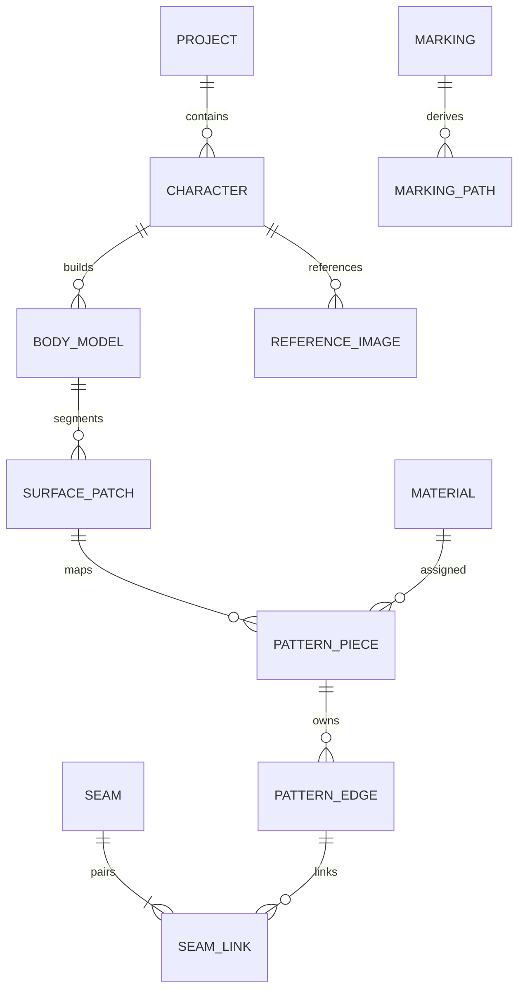

> 页面说明更新（2026-10-07）：当前主导航为花纹提取 → 模型管理 → 花纹映射 → 开裁 → 制版。3D 只在中间三页显示；制版含二维及制作流程次级功能。本文涉及旧页面的入口或布局按 [46 章](46-五页职责与共享功能模块.md) 更正，历史记录不作为当前页面设计依据。

# FurryPattern CAD — 数据模型、存储与项目格式设计

> 文档编号：FPCAD-SE-05 · 版本：0.1.0 · 日期：2026-09-11
> 状态：待评审工程基线；设计/目标不代表已实现或测试通过。
> 需求来源：母文档§9～22、24、35、44、46、50、61、74、83、105～110；新增工程约束按00的标记规则处理。

[返回文档总览](00-文档总览与使用指南.md) · [需求追踪](23-需求追踪矩阵.md) · [决策与待决](26-架构决策与待决事项.md)

## 数据归属和生命周期

[补] 工作库 SQLite 保存当前可编辑项目和命令日志；.fpcad 是可携带的 ZIP 快照，不在 ZIP 内直接运行数据库。应用私有库保存设置、账号引用与授权缓存，禁止把许可证令牌、设备标识和账号凭据打入项目包。Main 仓储单写者维护事务，foreign_keys 开启，崩溃恢复使用 WAL 与完整性检查。

实体 UUID 字符串稳定，revision 为非负整数，时间为 UTC RFC3339。删除采用命令级 tombstone，引用重定向必须原子完成。项目快照与历史 GC 分开；只有不被当前状态、恢复点和保留历史引用的内容才可回收。

## 逻辑关系

## 表字典（所有项目表带 project_id；所有可变实体带 revision）

|表|关键字段|约束与索引|
|---|---|---|
|projects|id,name,revision,format_version,schema_version,created_at,updated_at|id PK；revision 乐观锁|
|characters|id,project_id,name,species_id,measurement_json,morph_json|species_id FK；(project_id,id) 唯一|
|species|id,version,asset_hash,leg_types_json,constraints_json|项目内模板快照；不可悄悄跟随全局模板变化|
|body_models|id,character_id,topology_version,mesh_hash,parameter_hash,status|mesh_hash 引用内容寻址资源|
|body_parameters|body_id,key,value,unit,source|PK(body_id,key)；unit 枚举 mm/rad/ratio|
|reference_images|id,character_id,view,asset_id,calibration_json|scale>0，矩阵可逆；保留原图变换链|
|markings|id,source_image_id,semantic_type,mask_hash,color,confidence,status|confidence∈[0,1]；人工来源允许 null|
|marking_paths|id,marking_id,path_json,role,patch_id,mapping_hash|role boundary/seam/cut；按 marking_id 索引|
|surface_patches|id,body_id,face_ids_hash,topology_version,status|face IDs 必须属于该拓扑版本|
|pattern_pieces|id,patch_id,material_id,outer_path_id,cut_path_id,metadata_json|一片允许手工来源无 patch；制造状态单列|
|paths|id,role,nodes_json,segments_json,closed|节点/段有稳定 ID；closed 布尔|
|pattern_edges|id,piece_id,path_id,t0,t1,allowance_json|0≤t0<t1≤1；段参数相对于指定 path version|
|seams|id,name,expected_ease_mm,tolerance_mm,status|公差非负；吃量有符号|
|seam_links|id,seam_id,edge_id,side,direction|普通接缝恰有 A/B 两侧；边界缝单侧且显式分类|
|uv_maps|id,patch_id,map_hash,algorithm_run_id,unit|UV unit 明示；不可冒充 mm 纸样|
|materials|id,name,category,thickness_mm,fur_required,grain_required,properties_json|厚度≥0；属性含测量来源和版本|
|nesting_sheets|id,material_id,width_mm,length_mm,placements_json,dependency_hash|放置引用 piece+revision+instance_id|
|exports|id,project_revision,format,options_json,artifact_hash,validation_hash|仅成功生成后标 success|
|assets|id,mode,sha256,relative_path,external_uri,size_bytes,mime|embedded/external/linked；sha256 唯一索引|
|commands|id,project_id,base_revision,new_revision,type,payload,inverse,checksum|UNIQUE(project_id,new_revision)；有序可重放|
|algorithm_runs|id,input_hash,algorithm_id,version,options_hash,seed,result_hash,status|缓存 key 不包含随机运行时间|
|recovery_points|id,project_id,revision,snapshot_hash,created_at|仅引用完整提交|
|licenses / feature_entitlements / app_settings|本地私有库，key_id/token_ref/features/settings|不得导出到项目包|

复合外键或服务校验保证跨项目引用被拒绝。JSON 字段按 schemaVersion 验证，不能以“灵活 JSON”为由省去类型、范围和必填约束。大型 mesh/mask 放 assets，数据库存引用，提交前校验资源存在且 hash 一致。

## 关键结构语义

Path={id,revision,closed,nodes:[{id,xMm,yMm}],segments:[{id,type:'line'|'cubic',from,to,c1?,c2?}]}。控制点与节点坐标都为 mm；连续性以节点引用确定。PatternPiece 保存 outerBoundary、holes、seamLine、cutLine、逐边 allowance、notches、fur/grain rad、cutQty、mirror、material、来源和失效状态。Notch 以 edgeId+归一化弧长定位，不能仅保存屏幕坐标。

SurfaceBinding={bodyId,topologyVersion,faceId,barycentric:[u,v,w],side,sourceRevision}，u+v+w≈1 且分量在允许边界内。映射记录 patch→piece 的展开变换、缝线边界两侧副本和 orientation。拓扑变化必须提供旧新 ID remap；无可靠映射则 stale。

## .fpcad v1 内容

沿用母文档的 manifest.json、project.json、character.json、body.json、markings.json、patterns.json、seams.json、uv.json、materials.json、nesting.json、simulation.json 与 thumbnails/references/assets/history。未启用模块也输出带 schemaVersion 的空集合，不以缺失文件表示多种状态。

manifest 另含 schemaVersion、migrationVersion、files:[{path,size,sha256}]。contentHash 定义为按 UTF-8 路径排序后的 files 清单规范 JSON 的 SHA-256；清单不含 manifest 本身，避免循环哈希。ZIP 时间戳不进入内容哈希。hash 提供完整性，不提供来源真实性。

## 原子保存与自动恢复

编辑命令：校验→同一事务写 domain、command/inverse、revision→commit→内存快照发布。写临时资源先落盘再提交引用，失败产生的未引用资源稍后 GC。

自动保存：普通编辑防抖 3 秒、连续编辑最多 30 秒建立恢复快照，大计算接受后立即建立恢复点，默认保留最近 10 个。显式保存：固定 revision→写同目录临时 ZIP→校验每项 hash→flush→原子替换目标→更新成功标记。替换失败保留旧文件和恢复快照；禁止先删原文件。导出前固定并持久化快照，保存失败停止制造导出。

Undo 使用已保存逆补丁，Redo 使用原始确定性补丁；重做不重新运行可能升级的算法。Undo 后新编辑清空当前 redo 分支，但保留恢复策略要求的版本。磁盘不足时明确显示“未保存”，不能假报成功。

## 迁移与损坏处理

每次迁移 vN→vN+1 为可测试函数，先备份，写新工作副本，验证引用/几何/资源后切换；失败不改源包。不支持的新 major 以受限只读方式或明确拒绝打开，不覆盖保存。未知可选扩展字段原样保留；未知必需特性拒绝可写打开。外链缺失保留元数据和占位图，重定位时核验哈希并作为命令记录。

ZIP 导入拒绝绝对路径、..、符号链接、重复路径、大小写碰撞和超限解压；限额见 19。迁移测试至少覆盖最早支持版本到当前版本和中途故障。
