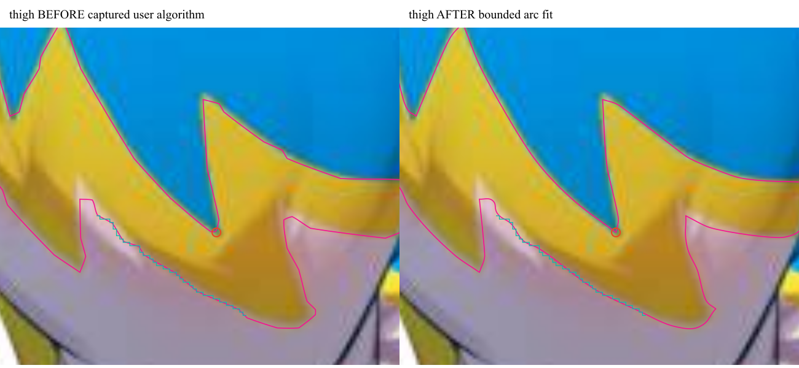
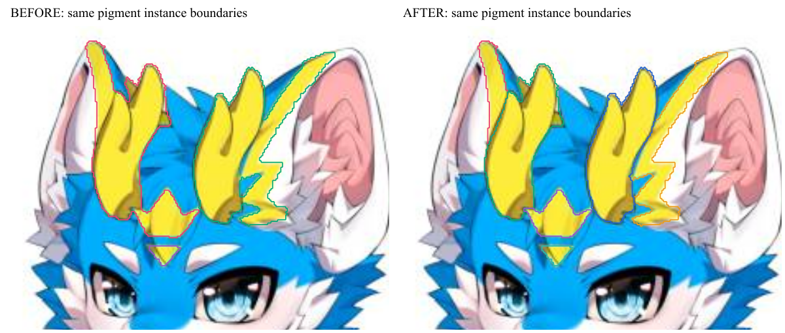
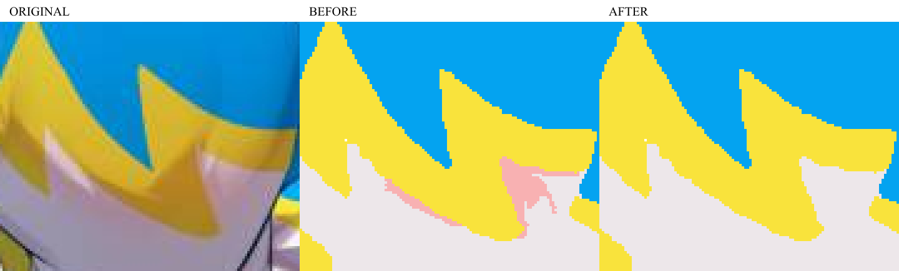

# 花纹边界、阴影与同色结构修复验收

日期：2026-10-09。当前发布构建 `dc42878b`。类型检查、91个文件中的453项单元／集成测试、13项原生几何测试及50套桌面回归全部通过。重复构建／打包验证通过，包哈希与桌面测试所用程序一致。完整逐项结果、首轮失败及同包重测记录见同目录 `66-final-audit.json`。

## 使用新版结果

双击父目录的 `启动新版FurryCAD.cmd`。已有项目保留原先保存的花纹；在“花纹提取”页点击“按当前标定重新拆分”应用新版算法。此操作会替换花纹库和相关贴附，可撤销；已锁定来源需要先解锁。升级没有自动覆盖用户项目。

## 原图中实际修复的问题

| 问题 | 实施与证据 |
| --- | --- |
| 宽缓线条出现折角、短小波动 | 按弧长进行有位移限制的局部二次拟合；逐段限制曲线手柄，合并降低弯曲能量的冗余短段。每个候选仍检查原图边界误差、面积、自交、孔洞和狭缝。真实多尺度尖折保留原节点。 |
| 暖色阴影留下粉色碎片 | 黄色阴影回归黄色材料后，重新评估剩余粉色候选的材料支持，防止已移走的黄色像素继续支持白毛阴影。原图正面三块共477像素的假粉色区消失，8个真实内耳和肉垫区仍在；深粉色反例也保留。 |
| 角与黄色毛纹连在一起 | 使用有两侧亮部支持的窄暗线和独立外缘种子分隔同色结构，随后在原材料范围内进行测地填充。正面两个原连通区拆为角、额头和耳缘等5个独立区，不丢失黄色像素；平缓尾部、腿部阴影不被切碎。 |
| 新曲线在真实尺寸上传失败 | 发现5块原图区域只有138–420个编辑节点，却需要2367–6202个0.01毫米精度采样点。原生内核混用了2000节点限制。现将编辑节点与派生采样分别限额，派生外圈最多12000点、总圈最多24000点；不放宽编辑及布尔输出的2000节点限制。重复标识、自交、短边、坐标和孔洞检查保留，并用包围框加速密集采样验证。 |

黄色腿纹的对比采用同一分区掩模，旧侧使用本轮开始时捕获的旧拟合及旧拓扑预算，不把中间实验版本当作用户旧版。宽缓连续弧与邻近真实尖折分别评估：

- 控制节点：75 → 53；宽缓弧最大切线跳变：0.611667弧度 → 约0。
- 有效曲率符号反转：7 → 4；真实尖折的原坐标保留。
- 面积相对误差：0.4628% → 0.2169%；保守边界误差：1.271 → 1.312原图像素，仍在1.4像素限额内。该对照以1像素=1毫米标定，不能把像素误差直接当作所有项目的毫米精度。
- 旧曲线在节点处不连续，旧段内解析峰值曲率较小不能证明它更平滑。本次不宣称所有曲率指标都下降。

## 视觉复核

黄色腿纹图：洋红线为拟合结果；青色阶梯为同一原始像素边界参考，**不是右侧拟合结果**；红圈标记必须保留的真实尖折。

耳缘曲线另见 [耳缘前后对照](66-visual-checks/ear-before-after.png)。

## 整合与回归

三个GPT-6.1-sol high代理分别研究、实现与独立复核；主代理负责整合、原生内核修复、测试和发布。先建立实际原图红测，再检查发布程序保存后的曲线，而非只比较像素分区数量。

独立实际界面回归已通过：原图上传得到84个来源，其中81个包含可编辑曲线；正面黄色13区、背面黄色8区。重新拆分只提交一次修订，所有来源标识更新；一次撤销恢复全部原来源及参考图，重做恢复新版结果；另一隔离项目严格保持不变。角、额头、耳缘及肉垫归属使用保存后的曲线包围关系验证，页面错误为空，窗口全程隐藏。

首次整包验收发现原生采样预算问题，旧试验包的失败结果保留在最终审计摘要中。另有一项旧映射测试依赖用户当前项目内容，新轮设置 `FPCAD_MAPPING_FRESH=1`，在临时库生成固定模型与原图，保留全部映射断言。最终全套测试的构建、数量及逐项结果见审计JSON。

新包首轮还发现旧简单模式测试依赖误识别的粉色阴影来满足“腿部自动贴附”：旧基线唯一明确分到左右腿的来源是正面53/328像素、背面44像素的假粉色区；真实黄色腿纹在旧版也属于待分类。删除阴影后应保持这个歧义，不能为测试重新制造错误花纹或强行分类。回归改为先验证歧义拒绝，再通过应用公开操作把按原图坐标选中的真实腿纹明确分类，验证腿、臂贴附及后续审核；映射产品代码未因此改变。首轮失败及同包重测分别保留在审计中。

## 算法选择和边界

已检索SAM 3/3.1、SAM2、EfficientViT-SAM、图层分解和矢量化路线，官方来源、许可证及本机部署判断见 [算法研究](65-花纹边界算法研究.md)。本轮交付使用离线材料判定、受约束结构分隔与曲线拟合；没有下载或运行神经分割权重，也不声称其效果已经在本机验证。最新模型的物体分割能力并不直接等同于毛色、阴影与制造边界识别。

固定原图已覆盖截图里的问题，但不是任意画风的通用准确率证明。完全同色无边界的角与毛纹需要额外证据；贯穿区域的窄暗阴影可能与线稿像素外观相同。当前分隔得到独立结构，不等于可靠的“角”语义标签，部位分类仍需检查。

高质量拟合增加了计算量：相同84个分区的单次本机CPU观察，分区、描边及拟合合计约3.67秒 → 8.29秒；不含JPEG解码和最终原生分析，也不是p95延迟。计算在后台执行，保留取消机制。本次接受这一精度/耗时取舍，没有将其写成提速。

源代码修改已整合，当前权限将`.git`设为只读，因此未完成Git提交或分支合并。Rustfmt/Clippy的工具链配置访问限制仍未解除，不能记为通过。最终保留源码、固定测试、最新发布包与本次验收证据；清理只针对旧发布包和生成的测试数据，保留全部用户项目。
